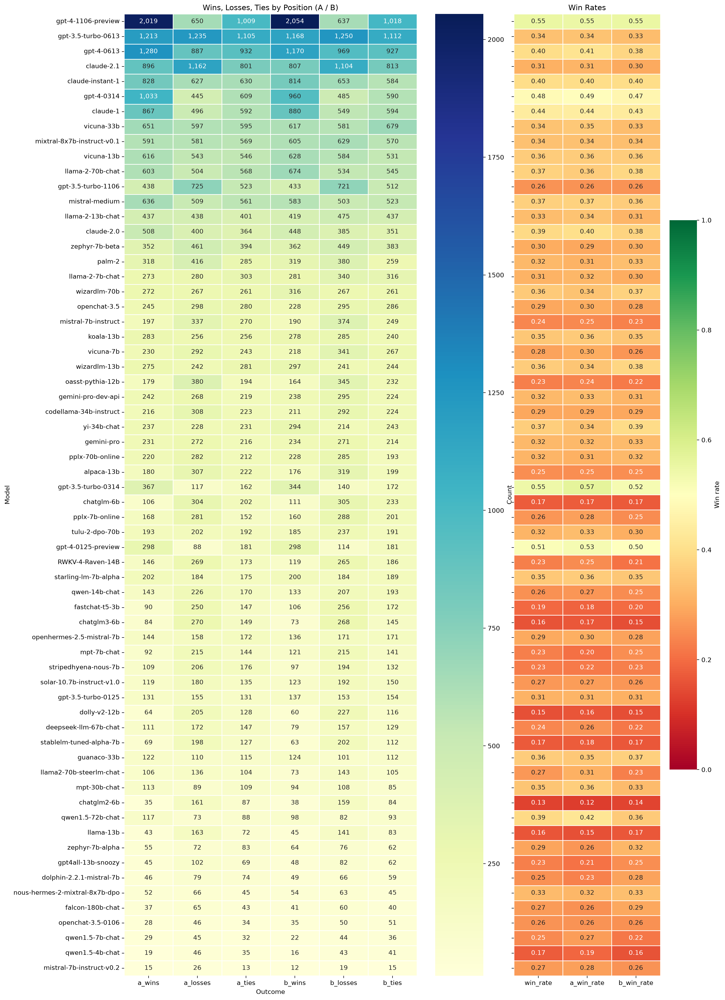

# LLM Classification Fine-Tuning — Chatbot Arena -Kaggle (Human-Preference Prediction)

> **Status: 🚧 In progress.** Exploratory analysis and a baseline submission pipeline are done. Modeling is next.

Kaggle competition: [LLM Classification Finetuning](https://www.kaggle.com/competitions/llm-classification-finetuning)

## Given Problem

Given a user prompt and two responses from different LLMs (A and B), predict which response a human preferred:

| Class | Meaning |
|---|---|
| `winner_model_a` | Response A preferred |
| `winner_model_b` | Response B preferred |
| `winner_tie` | Tie |

- **Type:** 3-class probabilistic classification on pairwise text data
- **Metric:** Log loss (lower is better)
- **Train columns:** `id, model_a, model_b, prompt, response_a, response_b, winner_model_a, winner_model_b, winner_tie`
- **Test columns:** `id, prompt, response_a, response_b` (no model names, so predictions must come from text features)

## Whats done so far,

**1. Exploratory data analysis**
- Counted wins, losses and ties for each of the 64 models, split by position (A / B).
- Computed per-model win rates to compare models with very different numbers of games.
- Visualized counts and win rates as side-by-side Seaborn heatmaps, sorted by total games (`unique_model_distribution.png`).

<!--  -->

*Left: win/loss/tie counts per model as model A and model B. Right: win rates. Models are sorted by total games, so rates near the bottom rest on fewer matches.*

**2. Fixed the logical pipeline**
- Fixed a loss count that was computed with the same formula as the win count.
- Found that the test set has no `model_a` / `model_b` columns, so per-model win rates can't be used as test predictions.
- Removed an ID-to-model pairing (`concat` / cross merge) that assigned arbitrary or all models to each test row and broke the submission on the hidden test set.

**3. Baseline submission**
- Built a submission pipeline that predicts training-set class priors for every row.
- Added checks for column order, row count and missing values before writing `submission.csv`.
- Fixed a Kaggle "incorrect format" scoring error caused by the issue above.

## Tech stack
Python, pandas, NumPy, Matplotlib, Seaborn, Kaggle Notebooks
